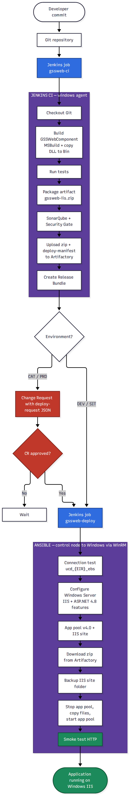
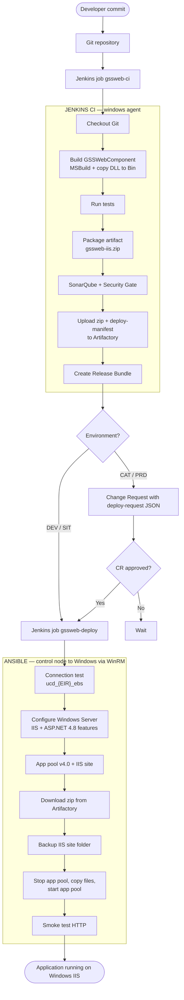

# Jenkins CI + Ansible CD — .NET to Windows IIS

End-to-end enterprise flow that replaces the local Jenkins job
which both built GSSWeb **and** copied it into localhost IIS.

Step-by-step notepad: [`docs/fixes/JENKINS-ANSIBLE-IIS-WINDOWS-STEPS.txt`](fixes/JENKINS-ANSIBLE-IIS-WINDOWS-STEPS.txt)

Previous Jenkins-only job (keep as reference, do not use for SIT/CAT/PRD):
[`docs/fixes/JENKINS-GSSWEB-IIS-PIPELINE.txt`](fixes/JENKINS-GSSWEB-IIS-PIPELINE.txt)



Plain-text Mermaid source: [`docs/jenkins-ansible-iis-flow.txt`](./jenkins-ansible-iis-flow.txt)



## Who does what

| Step | Owner | What happens |
| --- | --- | --- |
| 1 | Developer | Commit and push .NET code to Git |
| 2 | Jenkins `gssweb-ci` | Checkout, MSBuild GSSWebComponent, tests, zip `gssweb-iis.zip` |
| 3 | Existing EBS jobs | SonarQube, Security Gate, Artifactory upload, Release Bundle |
| 4 | Deploy request JSON | Names the bundle and the environment |
| 5 | DEV/SIT | Run deploy pipeline now |
| 5b | CAT/PRD | Change Request first, then the same deploy pipeline |
| 6 | Ansible | WinRM as `ucd_{EIR}_ebs`: IIS config, backup, copy files, smoke test |
| 7 | Windows IIS | Application running |

## Editing the diagram

```bash
npx -y @mermaid-js/mermaid-cli -i docs/jenkins-ansible-iis-flow.mmd -o docs/jenkins-ansible-iis-flow.png -s 2 -b white
npx -y @mermaid-js/mermaid-cli -i docs/jenkins-ansible-iis-flow.mmd -o docs/jenkins-ansible-iis-flow.svg -b white
```
